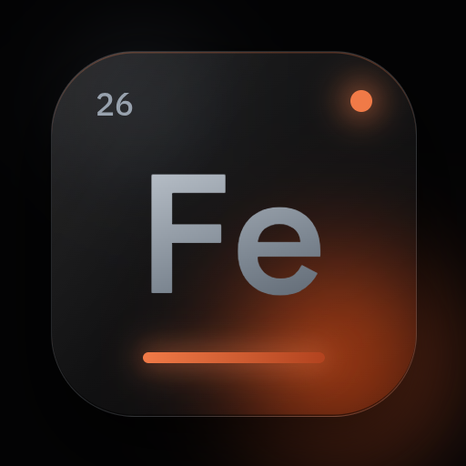

<p align="center"></p>

# Resume exactly, refuse the wrong corpus, cancel generation, trust `prepare`

Four small features, one how-to each, and the same resume rules for `finetune-gguf` (section 5). Every command and output below comes from a
real run on this machine with a tiny model (context 16, embed 16, 2 blocks, 2 heads,
hidden 32, vocab 300, `--threads 1`) on a generated 300-document corpus. The paths
are shortened to bare file names. Only what is marked "not run" was not run.

```bash
A="--context 16 --embed 16 --heads 2 --blocks 2 --hidden 32 --vocab 300 --seed 7 --threads 1"
```

## 1. Resume a run exactly, even mid-epoch

A checkpoint records where its epoch began (`ferrum.ckpt.epoch_rng`), so a run
stopped in the middle of an epoch replays the rest of that epoch's batches in the
original order. With the same flags and the same `--threads`, the resumed run ends
on the same bytes as an uninterrupted one.

First the uninterrupted run (3 epochs = 45 steps, 15 per epoch):

```text
$ train_transformer train corpus.txt full.gguf $A --epochs 3 --tokenizer tok.gguf --checkpoint full.fckp
  epoch     1/3   loss = 4.457293
  epoch     2/3   loss = 3.101227
  epoch     3/3   loss = 2.771075
$ train_transformer info full.fckp | grep -i step
Step      : 45
```

Now stop after 22 steps (a token budget of 22 x 16 x 16 = 5632 tokens; step 22 is
inside epoch 2), then resume with the same flags and `--resume`:

```text
$ train_transformer train corpus.txt mid.gguf $A --epochs 3 --tokenizer tok.gguf --checkpoint mid.fckp --tokens 5632
$ train_transformer info mid.fckp | grep -i step
Step      : 22
$ train_transformer train corpus.txt mid_r.gguf $A --epochs 3 --tokenizer tok.gguf --resume mid.fckp
  Resume  : mid.fckp
  epoch     2/3   loss = 2.993939
  epoch     3/3   loss = 2.771075
$ sha256sum full.gguf mid_r.gguf
b9bd24f8840257b6...  full.gguf
b9bd24f8840257b6...  mid_r.gguf
```

(Hashes cut to 16 characters.) The two models are byte-identical.

A checkpoint written by a build that predates `ferrum.ckpt.epoch_rng` still
resumes, but the rest of its partly finished epoch is reshuffled: the run ends close
to, not identical with, an uninterrupted one, and it prints a line starting
`note: the checkpoint (step N) predates ferrum.ckpt.epoch_rng`. Not run here: no
old-format checkpoint exists on this machine; the behaviour is covered by a unit
test in `ferrum_core`. See [Manual section 6](../Manual.md) (training and resume).

## 2. What the corpus identity refuses, and how to resume

A checkpoint written by `train --checkpoint` stores `sha256:<hex>` of the corpus
file as `ferrum.ckpt.corpus_id`. Resuming on a file with another hash is refused
with exit code 1 and the checkpoint is left untouched. Resume on the file the run
started with.

A corpus that differs by one appended word (`other.txt`):

```text
$ train_transformer train other.txt o.gguf $A --epochs 3 --tokenizer tok.gguf --resume mid.fckp
error: dimension mismatch: the checkpoint was trained on corpus sha256:0e640f3e...a320ba, this run's corpus is sha256:8f622422...b4c1; resume on the corpus it was started with (a text corpus and the token file made from it have different ids, so neither resumes the other's checkpoint)
$ echo $?
1
```

The id belongs to the file, not to its text, so a text corpus and the token file
made from it (`tokenize`) are different corpora to this check, in both directions:

```text
$ train_transformer tokenize corpus.txt --tokenizer tok.gguf --out corpus.tok.gguf
tokenized corpus.txt -> corpus.tok.gguf: 3723 tokens, 300 documents, vocab 300 (15860 bytes in, 7894 bytes out, 0.0s)
$ train_transformer train corpus.tok.gguf t.gguf $A --epochs 3 --tokenizer tok.gguf --resume mid.fckp
error: dimension mismatch: the checkpoint was trained on corpus sha256:0e640f3e...a320ba, this run's corpus is sha256:c6ee4975...0da8; ...
$ echo $?
1
```

(Ids and the tail of the message shortened with `...`.) A checkpoint without the
key (older build), or a run without `--checkpoint`, resumes without the check.
So: keep the corpus file with its checkpoint, and if you switch to a token file,
start a new run.

## 3. Cancel generation from the library

`SamplingParams.cancel` is an optional `Arc<AtomicBool>`. Set it from any thread, or
from the text callback, and the decode loop stops before its next token and returns
`Ok` with the text already streamed; `Generation.cancelled` is then `true`.
With the flag unset (or `None`, the default) output is bit-identical to before.

```rust
use std::sync::{atomic::{AtomicBool, Ordering}, Arc};

let stop = Arc::new(AtomicBool::new(false));
let p = SamplingParams { cancel: Some(stop.clone()), ..SamplingParams::default() };
let g = slm.generate_tokens_with("Once", 500, &[], &p, &mut Rng::new(1), &mut |frag| {
    print!("{frag}");
    if frag.contains('.') { stop.store(true, Ordering::Relaxed); } // or from a Cancel button
})?;
println!("\ncancelled: {}", g.cancelled);
```

Not compiled or run in this tutorial (it needs a loaded `slm`); it is the snippet
from [Manual section 7](../Manual.md), and the signature was checked against
`ferrum_core/src/slm/generate.rs`. The behaviour (before the first token, after k
tokens, mid multi-byte character, held-back stop text, no-flag bit-identity) is
unit-tested in `ferrum_core`.

## 4. `prepare` has a commit marker

`prepare` writes everything to `*.part` files, removes any old `manifest.json`,
renames the splits into place and renames the new manifest last. So a
`manifest.json` in the output folder always describes a complete set; an output
folder without one is unfinished (a crash between the renames can leave a mix of
old and new splits) and you run `prepare` again.

```text
$ train_transformer prepare --input corpus.txt --out prep
$ ls prep
manifest.json  test.txt  train.txt  val.txt
```

In scripts, test for the manifest before using a prepared folder:
`test -f prep/manifest.json || train_transformer prepare ...`. A `*.part` file left
behind is harmless and is replaced by the next run. The DVC `prepare` stage
tracks the manifest in git, so a changed manifest is a changed dataset.

## 5. The same for `finetune-gguf`

A `.flck` records the corpus id, the batch, `--seq`, the learning-rate settings and where
its epoch began, so `finetune-gguf --resume` follows the same rules as `train --resume`.
Run on 2026-11-03 with the synthetic tiny llama the tests build (`base.gguf`: dim 8,
2 layers, a 32-letter vocabulary, context 16) and a 31-character corpus:

```bash
F="--epochs 3 --batch 4 --seq 8 --lr 1e-2 --dropout 0.1 --warmup 2 --threads 1"
```

```text
$ train_transformer finetune-gguf base.gguf c.txt full.flck $F
  24 windows · 6 steps/epoch
  epoch   1/3  loss 3.4522  ppl 31.57  [0.0s, 154712 tok/s, lr 8.54e-3]
  epoch   2/3  loss 3.3973  ppl 29.88  [0.0s, 161901 tok/s, lr 3.09e-3]
  epoch   3/3  loss 3.3635  ppl 28.89  [0.0s, 160604 tok/s, lr 0.00e0]
$ touch part.flck.stop
$ train_transformer finetune-gguf base.gguf c.txt part.flck $F
  epoch   1/3  loss 3.4699  ppl 32.13  [0.0s, 833066 tok/s, lr 5.00e-3]
stopped early at step 1: stop file found; resume with --resume part.flck
$ train_transformer finetune-gguf base.gguf c.txt rest.flck $F --resume part.flck
  resumed from part.flck at step 1
  epoch   1/3  loss 3.4486  ppl 31.46  [0.0s, 187161 tok/s, lr 8.54e-3]
  epoch   2/3  loss 3.3973  ppl 29.88  [0.0s, 164668 tok/s, lr 3.09e-3]
  epoch   3/3  loss 3.3635  ppl 28.89  [0.0s, 160665 tok/s, lr 0.00e0]
$ sha256sum full.flck rest.flck
a226bd5a87a3d06d...  full.flck
a226bd5a87a3d06d...  rest.flck
```

Step 1 is inside the first 6-step epoch; the resume replays its other 5 steps (the first
"epoch" line of the resumed run is that rest, so `--epochs 3` again) and the checkpoints
are byte-identical. Another corpus, another batch, and a new learning rate:

```text
$ train_transformer finetune-gguf base.gguf d.txt x.flck $F --resume part.flck
error: dimension mismatch: the checkpoint was trained on corpus sha256:58b9dba5...6cf2, this run's corpus is sha256:1db33607...825c; resume on the corpus it was started with
$ echo $?
1
$ train_transformer finetune-gguf base.gguf c.txt x.flck $F --resume part.flck --batch 2
error: dimension mismatch: --batch is 2 but the checkpoint was trained with batch 4; a resume with another batch is a different run (window order and step count change). Resume with --batch 4, or start a new run
$ train_transformer finetune-gguf base.gguf c.txt y.flck $F --resume part.flck --lr 5e-3
note: training settings changed since the checkpoint was written (lr 0.01 -> 0.005); the resumed run will not match an uninterrupted one
```

(Ids and hashes shortened with `...`; lines of the banner left out.) A `.flck` written
before these keys existed resumes as before with `note: the checkpoint predates its
recorded corpus, epoch and training settings; ...`. Not run here from the command line
(no older build's `.flck` of a GGUF model exists on this machine); a unit test in
`ferrum_core` resumes such a checkpoint.
